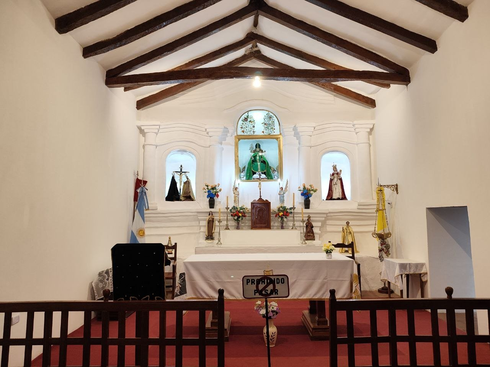
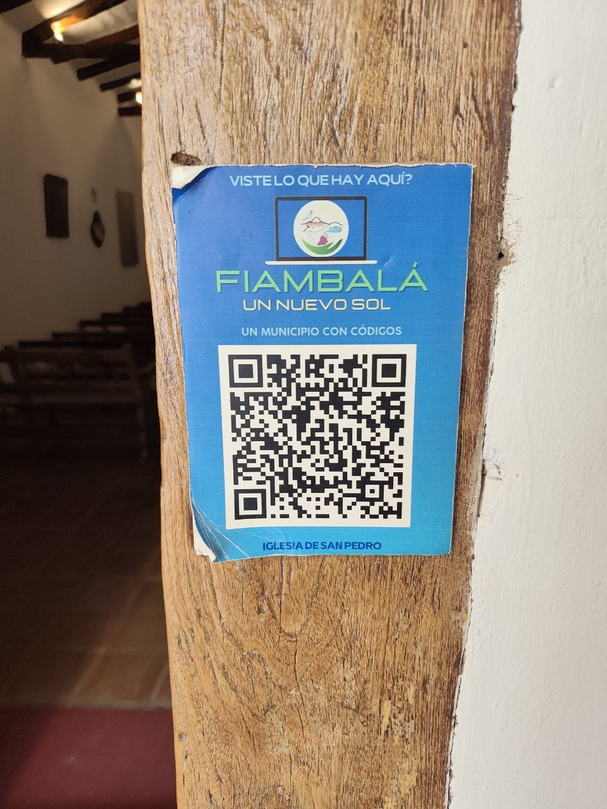
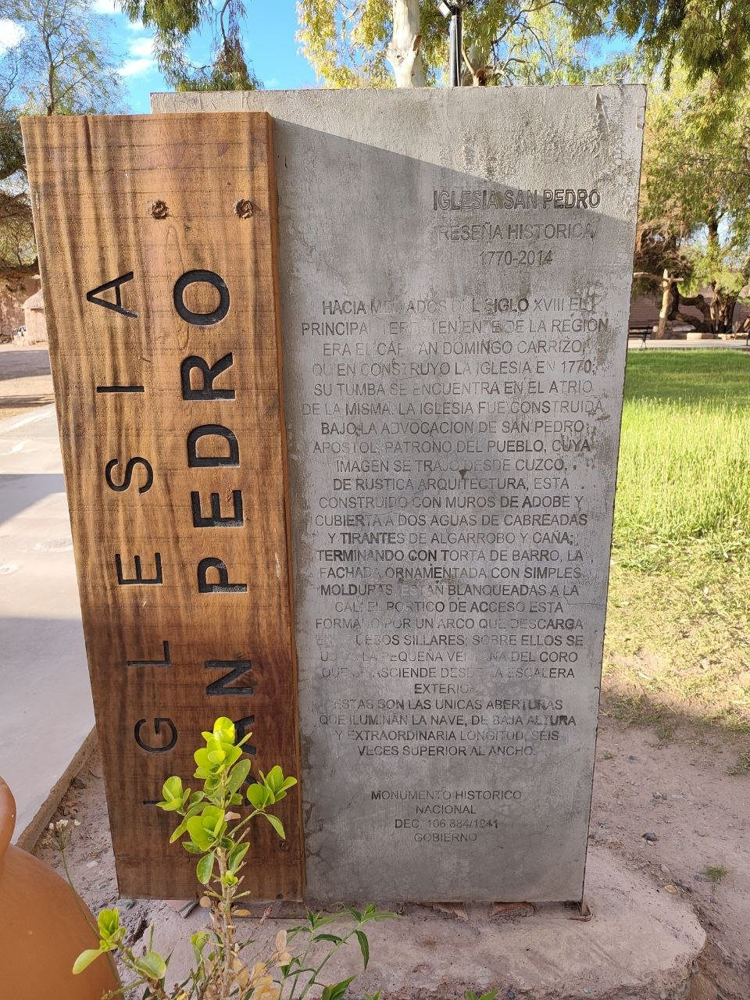
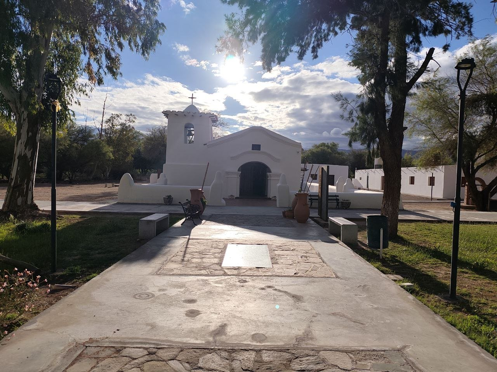
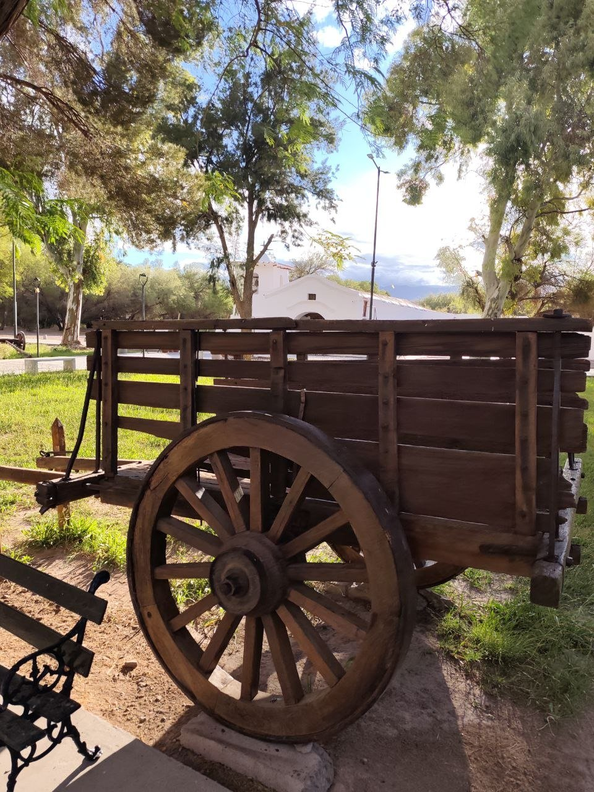
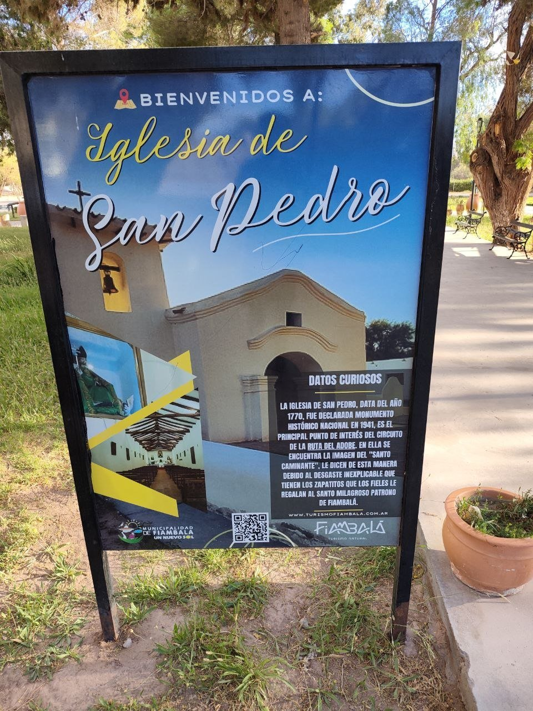
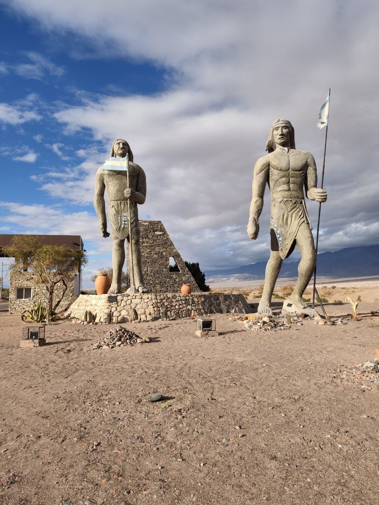
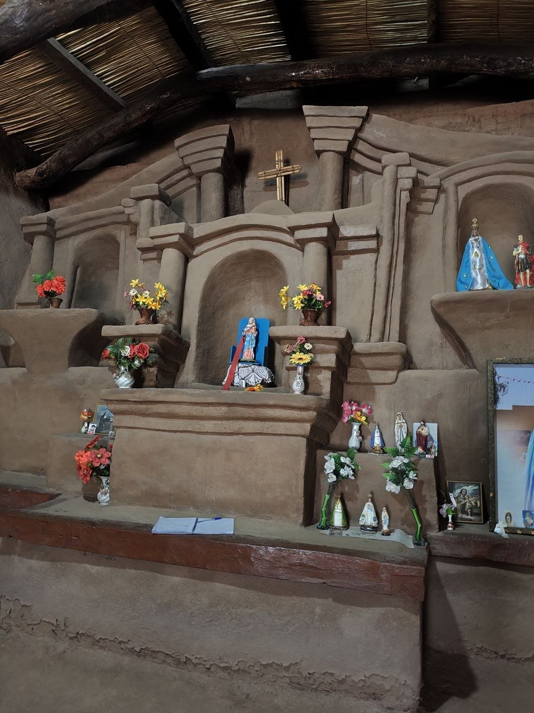
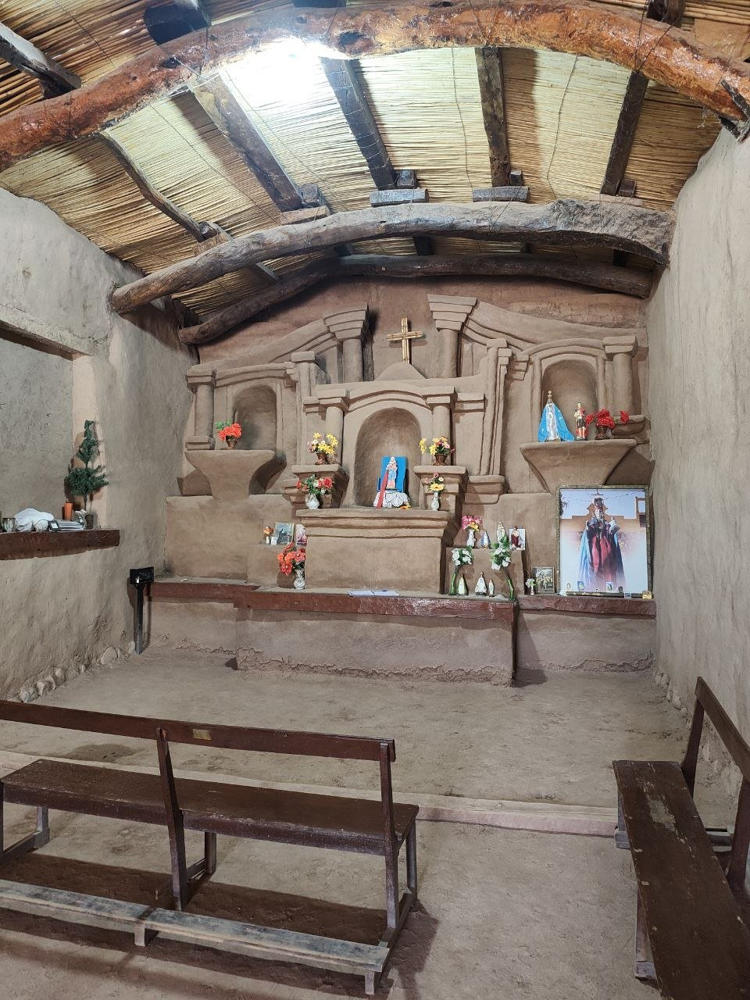
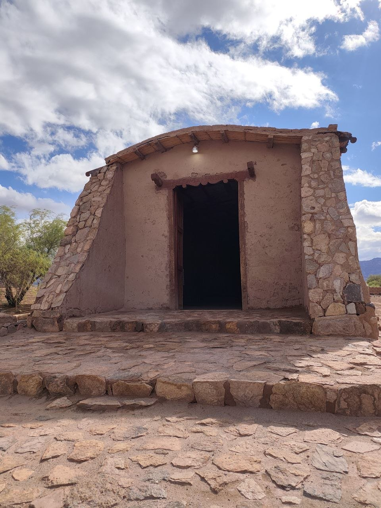

Es todo lo que hicimos de camino de tinogasta a fiambala, creo que es conocido como los pueblos de adobe o similar, ahora empezaré a hacer post y artículos dentro de la provincia de Catamarca, al llegar a fiambala nos hemos quedado pernoctando en el museo del hombre, al lado de los bomberos. Ahora daremos una vuelta para ver temas de excursiones en la ofcina de turismo algunos puntos de interés no podemos hacerlos con vehículo propio.
